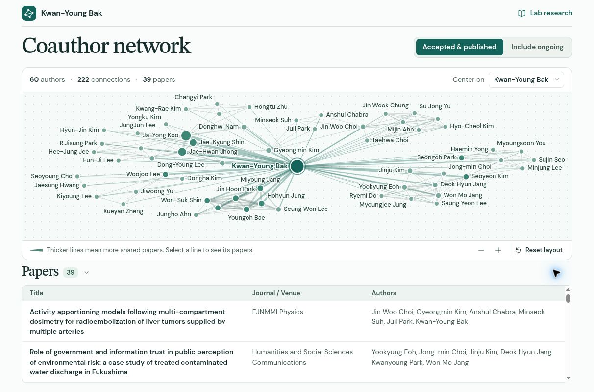

# Coauthor network

Kwan-Young Bak이 참여한 연구에서 어떤 저자들이 몇 편을 함께 썼는지 보여 주는 공개 그래프다. **Accepted & published**는 게재 확정·게재 논문을, **Include ongoing**은 여기에 연구실이 공개한 진행 원고를 더한 결과를 보여 준다. [GitHub Pages에서 열기](https://kybak90.github.io/coauthor-network/)



## 그래프와 표

- 이름을 누르거나 **Center on**에서 저자를 고르면 그 사람을 중심으로 연결이 강조된다. 노드를 끌어 배치를 바꾸고 빈 공간을 끌어 이동할 수 있다. 확대·축소와 **Reset layout**도 지원한다.
- **Papers**의 한 행을 누르면 그 논문의 저자와 모든 공저 연결이 함께 강조된다. 같은 행을 다시 누르면 선택이 풀린다. 선을 누르면 두 사람의 공동 논문만 보이고, **All papers**로 전체 목록에 돌아간다.
- 두 보기는 같은 좌표계를 쓴다. 현재 보기와 직접 옮긴 좌표는 같은 브라우저에 저장된다. 열린 탭은 다시 활성화되거나 5분이 지날 때 작은 버전 파일을 확인하고, 데이터가 바뀌면 현재 선택과 배치를 가능한 범위에서 복원한다.

## 데이터와 집계

빌드는 연구실 홈페이지 `main`의 커밋 SHA를 한 번 정한 뒤 그 커밋의 `_bibliography/papers.bib`와 `_pages/publications.md`만 읽는다. 게재 목록에서는 제목·저자·학술지/학회와 중복 판정에 필요한 서지 필드를 사용한다. Work in Progress에서는 공개 행의 제목과 순서가 있는 전체 저자명만 추출한다. 접힌 이름은 페이지에 들어 있는 문자열을 읽는다. [연구실 Research 페이지](https://kybak90.github.io/publications/)

한 편에 참여한 서로 다른 두 사람의 모든 조합에 한 편씩 더한다. 단독 논문은 저자 한 명과 표의 한 행으로 표시된다. 책, 보고서, 패키지 배포물 및 arXiv 단독 실적은 제외한다. 정식 소프트웨어 논문과 학술대회 논문은 포함한다. DOI를 우선 대조하고, DOI가 없는 항목은 정규화한 제목과 전체 저자 ID 집합을 대조한다. 같은 논문의 여러 상태가 겹치면 정식 게재 정보를 사용한다. BibTeX 키는 논문 식별자로 쓰지 않는다.

`Kwan-Young Bak`과 `Kwanyoung Park`는 같은 저자 ID를 쓴다. HSSC 논문에서는 지시서에 지정된 다섯 번째 저자의 표기 `Kwanyoung Park`를 표에 표시한다. 이 규칙은 해당 DOI·순서·저자 ID가 모두 일치할 때 적용한다. [작업지시서](coauthor-network-brief.md)

### 기준 스냅샷

2026년 11월 24일의 공개 BibTeX 47건에서 8건을 제외했고, 공개 진행 원고는 17편이었다. 이 수치는 고정된 원본에 대한 회귀 테스트에 사용한다. 운영 빌드는 최신 `main`을 읽는다. [검증 커밋](https://github.com/kybak90/kybak90.github.io/tree/be7b4065287dd801c2070506dc53b80d0dc23558)

| 항목 | Accepted & published | Include ongoing |
| --- | ---: | ---: |
| 논문 표의 행 | 39 | 56 |
| 저자 | 60 | 70 |
| 고유 저자 쌍 | 222 | 280 |
| Kwan-Young Bak · Woojoo Lee 공동 논문 | 3 | 7 |
| Jiwoong Yu · Woojoo Lee 공동 논문 | 1 | 2 |

HSSC 논문을 선택하면 저자 6명과 선 15개가 강조된다. AAAI의 ALTBI와 SoftwareX의 논문은 게재 목록에 들어간다. FastKRR 패키지 논문은 진행 원고에만 있으며, 홈페이지에 접혀 있는 다섯 번째 저자는 Kwan-Young Bak이다.

## 로컬 실행과 테스트

Python 3.12로 저장소 최상위에서 실행한다. 데이터 빌드와 고정 스냅샷 테스트에는 공개 GitHub 원본을 읽을 인터넷 연결이 필요하다.

```sh
python3 -m venv .venv
source .venv/bin/activate
python -m pip install -r requirements-test.txt
python -m unittest discover -s tests -v
python -m scripts.build
python tests/browser.py
python -m http.server 8080 --bind 127.0.0.1 --directory dist
```

브라우저에서 `http://127.0.0.1:8080/`을 연다. 브라우저 테스트는 설치된 Chrome 또는 Chromium을 사용한다. 실행 파일을 `CHROME_BIN`으로 지정할 수 있으며, 설치된 브라우저가 없으면 `python -m playwright install chromium`으로 테스트용 브라우저를 준비할 수 있다. 특정 원본을 재현하려면 `python -m scripts.build --commit be7b4065287dd801c2070506dc53b80d0dc23558`을 실행한다.

## GitHub Pages와 자동 갱신

저장소 **Settings → Pages → Build and deployment → Source**에서 **GitHub Actions**를 선택한다. 공개 표준 Ubuntu 러너와 저장소에서 발급하는 기본 `GITHUB_TOKEN`을 사용한다. 연구실 홈페이지 저장소에는 읽기 요청만 보낸다. [Pages 설정](https://github.com/kybak90/coauthor-network/settings/pages)

이 저장소의 `main` 푸시와 매일 **한국 시각 오전 6시 17분** 예약 실행에서 두 원본을 점검한다. GitHub의 예약 실행은 대기열에 따라 늦어질 수 있다. 즉시 확인하려면 **Actions → Update coauthor network → Run workflow**를 누른다. [워크플로 실행 기록](https://github.com/kybak90/coauthor-network/actions/workflows/pages.yml)

워크플로는 집계 규칙을 테스트하고 최신 정적 앱을 만든 뒤, 데이터와 앱의 해시를 운영 버전과 비교한다. 변경이 있으면 Chromium에서 그래프와 표의 상호작용을 테스트하고 통과한 산출물을 Pages에 배포한다. 수집·검증 실패 시 직전 배포가 계속 서비스된다. 각 실행의 요약에는 원본 커밋과 두 보기의 집계 결과가 남는다.

GitHub는 공개 저장소에 60일간 활동이 없으면 예약 실행을 비활성화한다. 그 경우 **Actions → Update coauthor network → Enable workflow**에서 재개할 수 있다. [GitHub의 예약 실행 안내](https://docs.github.com/en/actions/reference/workflows-and-actions/events-that-trigger-workflows#schedule)
